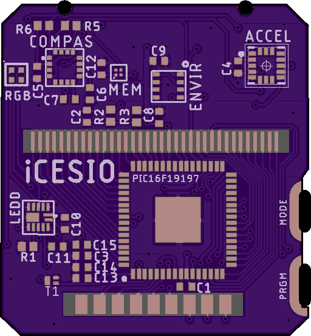
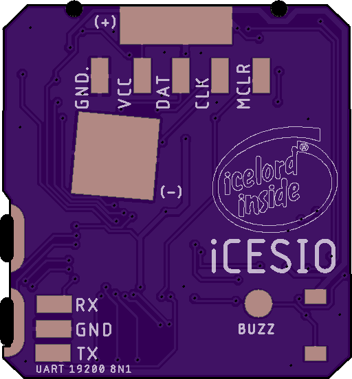
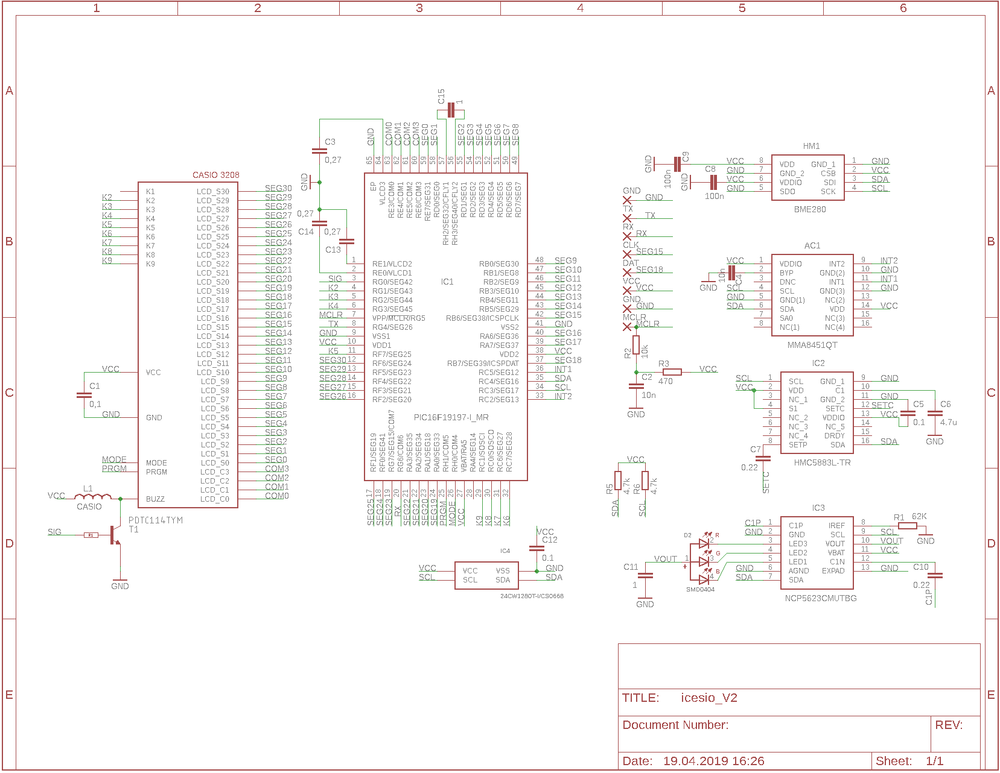

# iCESIO

**A replacement brain for the CASIO 3208 module** — the one inside the CA-53W and CA-506 calculator watches.
iCESIO keeps the original case, LCD, keypad and buzzer, and swaps the stock chip for a PIC16 microcontroller
with an accelerometer, a compass, an environmental sensor and a full RGB backlight.

<p align="center">
  
  &nbsp;&nbsp;
  
</p>

> **Status:** work in progress. The hardware (rev. V2) is done; the firmware shows and sets the time,
> beeps and talks to the sensors over I²C. Most of the watch features listed below are still to come.

---

## Contents

- [Hardware](#hardware)
- [Firmware](#firmware)
  - [What works](#what-works)
  - [Using the watch](#using-the-watch)
  - [Building](#building)
  - [Configuration](#configuration)
- [Repository layout](#repository-layout)
- [Known issues](#known-issues)
- [Roadmap](#roadmap)
- [Related projects](#related-projects)
- [License](#license)

---

## Hardware

| Function       | Part                                                              | Notes                                         |
|----------------|-------------------------------------------------------------------|-----------------------------------------------|
| MCU            | Microchip **PIC16F19197**                                         | 8-bit, 56 KB flash, 4 KB RAM, 256 B EEPROM, LCD driver, RTCC |
| EEPROM         | Microchip **24CW1280T-I/CS0668**                                  | 16 KB, WLCSP                                  |
| Accelerometer  | NXP **MMA8451QT**                                                 | 3-axis, 14-bit / 8-bit                        |
| Compass        | Honeywell **HMC5883L** or Isentek **IST8310**                     | 3-axis magnetometer                           |
| Environment    | Bosch **BME280**                                                  | temperature, humidity, pressure               |
| RGB backlight  | ON Semi **NCP5623CMUTBG** + Songxin **SX-0402-RGB**               | I²C triple LED driver, 0404 RGB LED           |
| Battery        | **CR2016**                                                        | CR2020 / CR2025 / CR2320 might fit            |

All peripherals share one I²C bus. A 19200 bps TTL UART is available for debugging.

<p align="center">
  <a href="schematic.png"></a>
</p>

### Connections to the CASIO module

| CASIO pad      | MCU pin          | Use                                                      |
|----------------|------------------|----------------------------------------------------------|
| MODE           | RH0              | side button, active high (connects to +)                 |
| PRGM           | RH1              | side button, active high (connects to +)                 |
| SIG            | RG0 (PWM3 via PPS) | buzzer, through T1 (PDTC114) and the coil L1           |
| K2…K5          | RG1, RG2, RG3, RF7 | keypad rows (driven low)                               |
| K6…K9          | RC7, RC6, RC0, RC1 | keypad columns (inputs, weak pull-ups)                 |
| LCD_S0…S30, C0…C3 | LCD SEG/COM pins | 4-COM multiplexed LCD                                |

---

## Firmware

MPLAB X project in [`icesio.X/`](icesio.X), written in C for **MPLAB XC8**. Peripheral setup is generated
by MPLAB Code Configurator (`icesio.mc3`, [`mcc_generated_files/`](icesio.X/mcc_generated_files)).

| Module                                   | What it does                                                        |
|------------------------------------------|---------------------------------------------------------------------|
| [`main.c`](icesio.X/main.c)              | power-on self test over UART, main loop (100 ms tick)               |
| [`clock.c`](icesio.X/clock.c)            | time screen and time / date setting                                 |
| [`buttons.c`](icesio.X/buttons.c)        | MODE / PRGM debouncing, auto-repeat, software pull-down             |
| [`beep.c`](icesio.X/beep.c)              | buzzer: ~4 kHz hardware PWM, key click                              |
| [`keypad.c`](icesio.X/keypad.c)          | 4×4 keypad matrix scan with debouncing                              |
| [`lcd.c`](icesio.X/lcd.c)                | 7-segment font and table-driven LCD segment mapping                 |
| [`led.c`](icesio.X/led.c)                | NCP5623C RGB LED driver                                             |
| [`bme280.c`](icesio.X/bme280.c)          | BME280 temperature / humidity / pressure                            |
| [`mma8451.c`](icesio.X/mma8451.c)        | MMA8451 accelerometer (based on [yangosoft/pic_mma8451](https://github.com/yangosoft/pic_mma8451)) |
| [`compass.c`](icesio.X/compass.c)        | HMC5883L compass (disabled for now)                                 |
| [`uart.c`](icesio.X/uart.c), [`debug.h`](icesio.X/debug.h) | debug output: `DBG_PRINT()` / `DBG_PRINTF()`, compiled only with `DEBUG` |

### What works

- [x] Power-on self test with progress on the debug UART (`DEBUG` builds)
- [x] Time display with a blinking colon and the day of month
- [x] Setting time and date with the side buttons or the keypad
- [x] Rate correction in s/day, stored in EEPROM
- [x] Key click on the buzzer
- [x] 4×4 keypad driver (test mode shows the pressed key)
- [x] RGB LED, BME280, MMA8451 and HMC5883L drivers
- [ ] Alarms, stopwatch, timer, calculator… — see the [roadmap](#roadmap)

### Using the watch

```
digit:  0 1 2 3 4 5 6 7     9 10
time:   H H : M M   S S     D  D      D D = day of month
date:   D D - M M - Y Y               shown while setting the date
```

| Mode        | Button   | Action                                                                 |
|-------------|----------|------------------------------------------------------------------------|
| Time        | **PRGM** | enter setting mode                                                     |
| Setting     | **PRGM** | next field: hour → minute → second → year → month → day → rate correction → done |
| Setting     | **MODE** | +1 to the blinking field; hold to scroll                               |
| Seconds     | **MODE** | reset to `00` and start the clock right away — press it on the time signal |
| Setting     | **0…9**  | type the field: two digits set it and jump to the next field (`1_` after the first digit) |
| Setting     | **=**    | same as PRGM; a single typed digit counts as `0x`                      |
| Setting     | **+ / −** | +1 / −1 to the field (on seconds: reset to `00`)                      |
| Setting     | **.**    | finish setting                                                         |
| Correction  | **MODE / +**, **−** | rate correction ±1 s/day; hold to repeat, after 3 s in steps of 10 |

Keypad (from the goodwatch firmware for the same module, matches the CA-53W):

|        | K6 | K7 | K8 | K9 |
|--------|:--:|:--:|:--:|:--:|
| **K5** | 7  | 8  | 9  | ÷  |
| **K4** | 4  | 5  | 6  | ×  |
| **K3** | 1  | 2  | 3  | −  |
| **K2** | 0  | .  | =  | +  |

With `KEYPAD_TEST` on, a key pressed on the time screen is shown as `KEY    7` for one second.

Typed values are checked: hours 00–23, minutes and seconds 00–59, year 00–99, month 01–12, and the day
must exist in that month (no 31 April, 29 February only in leap years). An impossible value is rejected
with a long beep. Typing the seconds starts the clock at the entered time immediately.

### Rate correction

Without a 32.768 kHz crystal the clock runs from the internal MFINTOSC, which can be off by up to ~2 %
(about ±1700 s/day). The last setting field, `Cor  -12`, holds a correction in **seconds per day**
(−1999…+1999), saved in the data EEPROM:

1. Set the time exactly and note how many seconds the watch gains or loses over a day or more.
2. Enter the measured drift per day with the opposite sign: the watch **gains** 12 s/day → `Cor -12`;
   it **loses** 300 s/day → `Cor 300`.

The firmware then moves the RTCC seconds by one every 86400 / |Cor| seconds, so the watch stays within
about a second. (The hardware `RTCCAL` register only reaches about ±6 s/day, too little for MFINTOSC.)

Setting mode also ends after 60 s without a press; changes are kept. Only the fields you changed are
written back, so entering and leaving setting mode never makes the clock lose time. The day of the week
is calculated automatically.

### Building

Requirements:

- [MPLAB X IDE](https://www.microchip.com/mplab/mplab-x-ide) (tested with v6.35)
- [MPLAB XC8](https://www.microchip.com/mplab/compilers) **v3.10**
- Device pack **PIC16F1xxxx_DFP 1.7.146**

Open `icesio.X` in MPLAB X and build, or from the command line (after MPLAB X has generated
`nbproject/Makefile-local-default.mk` for your machine):

```bash
cd icesio.X
make -f nbproject/Makefile-default.mk CONF=default .build-conf
```

Current size: **~6.0 K of 32 K words** program memory (18 %), **324 B** RAM; with `DEBUG` ~11.7 K (printf).

### Configuration

Compile-time switches, all at the top of their source files:

| Define              | File        | Default | Meaning                                                    |
|---------------------|-------------|---------|------------------------------------------------------------|
| `CLOCK_24H`         | `clock.c`   | `1`     | 24-hour display; `0` for 12-hour with AM/PM                 |
| `KEY_BEEP`          | `clock.c`   | `1`     | click on every button / key press                          |
| `KEYPAD_TEST`       | `clock.c`   | `1`     | show the pressed key on the time screen                    |
| `KEYPAD_ROW_K2`     | `keypad.c`  | `1`     | scan the bottom row on RG1; `0` keeps RG1 as UART TX       |
| `SET_TIMEOUT_S`     | `clock.c`   | `60`    | leave setting mode after this many seconds                 |
| `BTN_ACTIVE_LOW`    | `buttons.c` | `0`     | buttons connect to + (`0`) or to GND (`1`)                 |
| `BTN_SOFT_PULLDOWN` | `buttons.c` | `1`     | software pull-down, see [known issues](#known-issues)      |
| `BEEP_PR`           | `beep.c`    | `14`    | tone: 62.5 kHz / (`BEEP_PR` + 1) ≈ 4167 Hz                 |
| `BEEP_CLICK_MS`     | `beep.c`    | `30`    | key click length                                           |
| `USE_COMPASS`       | `main.c`    | `0`     | initialise and poll the compass                            |
| `DEBUG`             | `debug.h`   | off     | self-test log and a sensor dump every second on the UART (19200 bps, RG1) |
| `COR_MAX`           | `clock.c`   | `1999`  | rate correction limit, s/day                               |

---

## Repository layout

```
icesio.X/              firmware (MPLAB X project)
hardware/
  icesio.sch/.brd      Eagle, rev. V1
  icesio_V2.sch/.brd   Eagle, rev. V2
  icesio_V2/           rev. V2 imported into KiCad
  CHAGE LIST           V1 → V2 changes
kicad/                 KiCad import of icesio0
icesio0.*, icesio2.*   Eagle snapshots (2019)
icesio2_2019-03-12.zip Gerber + drill files of the 2019-03-12 board
icesio.docx            draft of the operation guide
front.png, back.png    board renders
schematic.png          schematic, rev. V2
```

---

## Known issues

- **No pull-downs on MODE / PRGM.** The buttons connect the pins to +, and the PIC16F19197 has no internal
  pull-downs. Until 100 k–1 M resistors to GND are added, the firmware discharges the pins before each read
  (`BTN_SOFT_PULLDOWN`). While a button is held this briefly (~50 µs every 100 ms) shorts the pin to +.
- **RTCC runs from MFINTOSC.** The SOSC crystal pins are used by the keypad, so the clock runs from the
  internal oscillator (about ±1–2 %, and it drifts with temperature). The [rate correction](#rate-correction)
  compensates the average error; a 32.768 kHz crystal is planned for the next board revision.
- **SEG17 / SEG20 share the ICSP CLK / DAT pins.** Eight segments are lost while debugging
  (`#ifndef __DEBUG` in `lcd.c`). To be rerouted in the next revision.
- **Debug UART vs. keypad.** K2 (RG1) is also the EUSART2 TX pin. The UART exists only in `DEBUG` builds;
  normal builds switch EUSART2 off and give RG1 to the keypad, debug builds keep the UART there and don't
  scan the bottom row (0 . = +).
- **SOSC and LCD pins used by the keypad.** `Keypad_Init()` switches off the secondary oscillator
  (RC0/RC1) and the unused LCD segments SEG27/SEG28 (RC6/RC7) that MCC had enabled.
- The keypad layout comes from goodwatch and has not been checked on this board yet.

---

## Roadmap

- **Controls:** 2 side buttons + 4×4 keypad
- **Timekeeping:** home and world time with automatic DST and assisted calibration
- **Perpetual calendar** up to 2199
- **Calculator:** infix, prefix or RPN (configurable), ±9.9999999 × 10<sup>99</sup> (8-digit mantissa)
- **Alarm:** 5 daily + 5 weekly alarms, hourly signal
- **Stopwatch:** 5 stopwatches up to 23:59:59.99, 0.01 s resolution
- **Timer:** 5 countdown timers up to 99:59:59
- **Signals:** RTTTL melodies for alarms and timers; minute repeater
- **Backlight:** full RGB, separate colours for alarms and timers
- **Sun and Moon:** sunrise / sunset (latitude presets + time zone), precise Moon phase, equation of time
- **Accelerometer:** tap control, tilt sensor, speedometer, 0–100 km/h timing
- **Compass:** regular compass, angle finder
- **Environment:** temperature (°C / °F), humidity, barometer (hPa, mbar, at, atm, Torr, mmHg, PSI, inHg),
  with hour / 12 h / 24 h trends

---

## Related projects

- [**goodwatch**](https://github.com/travisgoodspeed/goodwatch) — replacement board for the same CASIO 3208
  module (CA-53W, CA-506), based on the CC430
- [**Pluto**](https://github.com/carrotIndustries/pluto) — replacement PCB for the CASIO F-91W, based on an MSP430

---

## License

[MIT](LICENSE) © icelord75 — firmware, hardware design files and documentation.

Exceptions: files in [`icesio.X/mcc_generated_files/`](icesio.X/mcc_generated_files) are generated by
MPLAB Code Configurator and covered by Microchip's license terms in their headers;
[`mma8451.c`](icesio.X/mma8451.c) is based on [yangosoft/pic_mma8451](https://github.com/yangosoft/pic_mma8451).
